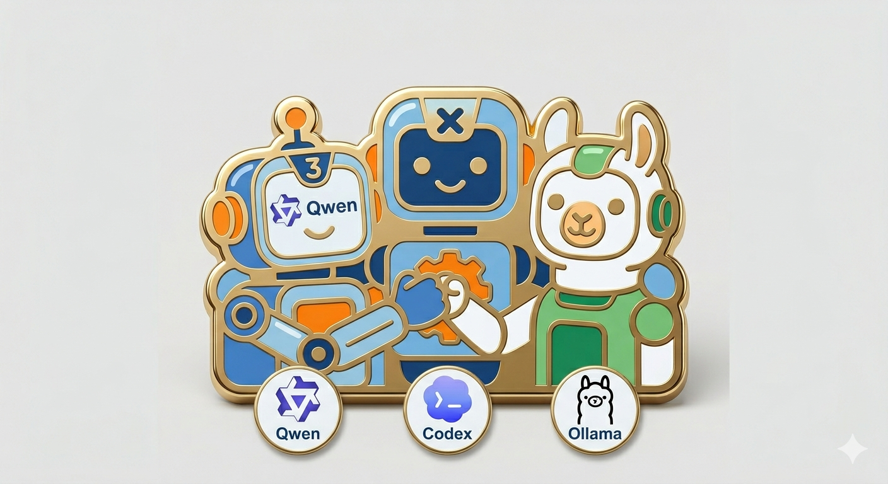

+++
title = "Qwen3.6とCodexは頑張らなくても使えそう"
date = "2026-06-17"

[taxonomies]
categories = ["Long Posts"]
tags = ["agentic coding", "codex", "qwen3.6"]

[extra]
cover = "qwen3coder-codex-ollama.png"
+++



## この記事は何

[Qwen3.6 35Bモデル](https://huggingface.co/Qwen/Qwen3.6-35B-A3B) をCodexのバックエンドモデルに指定して，個人開発用途を想定して使い始めました。

[Qwen3-Coderを個人開発用途で使おうと頑張ってみた](https://blog.mocobeta.dev/posts/20260406-qwen3-coder-codex/)の続編で，Qwen3 Coderからどう変わったかを中心に書いています。

## Qwen3.6 35B所感

実験用のPythonコードを書かせてみた感想ですが，Qwen3 Coderと比べてAgentic Coding力が飛躍的に進化しています。
Qwen3 Coderだとたくさんのチューニングとdirtyハックをしないとまともに動かなかったのが，ほぼVanillaの状態で使えるようになりました。
ただし，最新のCodexとの相性は微妙なとこがあります。

### ハードウェア
- PC: GMKtec EVO-X2
- プロセッサ: AMD Ryzen AI Max+ 395
- 内蔵GPU: Radeon 8060S
- メモリ: 128GB (うちGPUに96GBを割り当て)

### ソフトウェア
- OS: Ubuntu 24.04
- Graphics API: Vulkan
- LLMサーバー: Ollama
- コーディングエージェント: Codex

という構成です。なおLLMのサーバー(Ollama)とクライアント(Codex)は別PCですが，こまかいのでクライアントについては省略。

なおreasoning effortは常時 `High`（最高）を指定しています。

## Qwen3.6をOllama経由でCodexから使う方法

Vanillaの状態は，Ollamaがセットアップできればすぐに作れます。

[Ollamaのドキュメント](https://docs.ollama.com/integrations/codex)や[Codexのドキュメント](https://developers.openai.com/codex/config-advanced#custom-model-providers)に設定例が載っています。

## Qwen3-CoderをOllama経由でCodexから使う時に困ったことがQwen3.6だとどうなるか

以下，「[Qwen3-Coderで困ったこと](https://blog.mocobeta.dev/posts/20260406-qwen3-coder-codex/#qwen3-coderwoollamajing-you-decodexkarashi-ushi-nikun-tutakoto)」がだいたい解決していた話を書いていきます。

### Codexが知らないモデルだと警告を出す

これはQwen3.6でも同じです。
無視しても多分大丈夫なのですが，気になる場合はモデルカタログを作ります。`$HOME/.codex/models-qwen3-ollama.json` というようなファイルを（ChatGPTなどで）作って，`config.toml` に指定します。

```toml
model_catalog_json = "~/.codex/catalogs/models-qwen3-ollama.json"
```

Codexのバージョンによってモデルカタログの仕様が変わりますが， [models-qwen3-ollama.json](https://github.com/mocobeta/dotfiles/blob/main/.codex/catalogs/models-qwen3-ollama.json) とほぼ同じJSONで通りました。

### Codex経由だと起動後の初回レスポンスがものすごく遅い

これもQwen3.6でも同じです（多分）。
Ollamaプロセスを確認して，「PROCESSORが100% GPUになっているか（CPUにオフロードされていないか）」と「CONTEXTが65536よりも大きすぎないか」を見ます。前者については説明はいらないかと思います。後者については，コンテキストウィンドウが大きすぎるとKVキャッシュのウォームアップで時間を取られるようで，coding agentで使う際の最小推奨コンテキストウィンドウの64kに近い値を指定すると立ち上がりが速くなります。Ollamaのコンテキストウィンドウサイズの調整方法は，一番簡単なのはollamaサービス起動時の環境変数で`OLLAMA_CONTEXT_LENGTH=65536`のように指定します。

こんな感じになっていたら多分OK

```bash
$ ollama ps                 
NAME               ID              SIZE     PROCESSOR    CONTEXT    UNTIL
qwen3.6:latest        07d35212591f    28 GB    100% GPU     65536      47 minutes from now
```

### ツールコールがバグる

Qwen3-Coderで大問題だったツールコールの不具合は，おおむね解消していました。
バグ手当てのためにプロキシを挟んだりなど大変でしたが，Qwen3.6ではVanillaでもだいたい問題なく動作します（わーい！）。
だいたい，というのは，セッションが長くなるとやっぱりまだ時折壊れたXMLが返ってくることがあり，その場合は諦めて新しいセッションを立ち上げます。

### スキルが探せない，探せても実行中に失敗する

未確認

### やりますと言ってやらない

この点がおそらく一番改善したポイントです。
作業実行中にほぼほぼ止まらなくなりました。
作業完了したら，エージェントっぽく「次に何をするか」の提案もしてきます。
提案の挙動はOpusやGPT-5に寄せているようにも見えますが，Agentic Coding能力が大幅に向上した，というのは誇張ではなさそうです。

Qwen3.6の提案の具体例：
```
もし Qdrant のテストコードで nDCG ベンチマークを実装したい場合、`tests/` に `test_ndcg.py` を追加してサポートできます。その場合は、どのようなデータセットやユースケースを対象にしますか？
```

### やりましたと言ってやってない

この点も大幅に改善していました。
推論時のトークン生成を見ていると，頻繁に "Wait, ..." と独り言を呟いていて，このトリガーが働くと，動作検証などのセルフフィードバックを実行するようです。

### バックアップファイルを作業ディレクトリに作る

100回に1回程度 `.bak` ファイルを作っているかな？という程度。

### やっぱりバグった時は

一度何かのきっかけでバグると戻らないので，諦めて新しいセッションを起動します。

たとえば，稀に無限ループに陥ったりします。

## Qwen3.6向けインストラクションの置き場

`$HOME/.codex/AGENTS.md` でも良いですが，グローバルのAGENTS.mdを汚したくない場合は `$HOME/.codex/qwen3.6-instructions.md` のように分けておき，`config.toml` でモデル特有のインストラクションファイルを指定できます。

```toml
model_instructions_file = "~/.codex/qwen3.6-instructions.md"
```

でも，もうモデル特化のインストラクションを頑張る必要はないかもしれません。

## 残念ポイント：MCPが動かない

Qwen3-CoderとCodexの組み合せではMCPが問題なく使えたけれど，Qwen3.6とCodexだとMCP呼び出しが効きません。
いろいろ設定やインストラクションを試したけれども全然だめ。
モデルはMCPをサポートしているので，おそらく最新のCodexとの相性が悪いです。
とはいえ，最近はMCPをあまり使わなくなっていたため，私の環境では実害はさほどありませんでした。

## 残念ポイント：サンドボックス環境

Codexサンドボックスでは実行できなくなった操作が増えました。
たとえば`git commit`が動かなかったりしてちょっとつらい。
`.rules`で権限を与えてもだめ。
サンドボックス環境で許可されないコマンドの実行を試みた時に，昇格するかどうかも聞いてこない。
これもエージェントのサンドボックス実装との相性の問題な気がします。

## なぜCodex? Qwen Code使わないの？

Qwenシリーズに最適化された [Qwen Code](https://qwen.ai/qwencode) があるので，やっぱり素直にこっちを使うのがいいのだろうなと思います。

## 余談

エディタ（IDE）をVSCodeから[Zed](https://zed.dev)に変えました。
[ACP](https://zed.dev/acp)でCodex CLIと直接連携でき，何よりサクサク軽快に動くので気に入っています。
